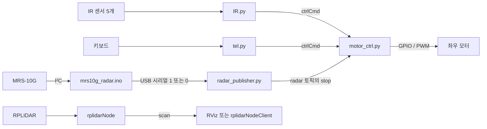

# ROS 라인 트레이싱 로봇

[한국어 개요](#노드와-데이터-흐름) · [English guide](#english-guide)

Ubuntu 20.04와 ROS Noetic에서 사용한 Raspberry Pi 이륜 로봇 프로젝트다. IR 센서 5개로 주행 방향을 결정하고, Arduino에 연결한 MRS-10G 레이더가 움직임을 감지하면 모터에 정지 명령을 보낸다. 키보드로도 같은 모터를 제어할 수 있다.

## 노드와 데이터 흐름



| 입력 | 처리하는 노드 | 출력 |
| --- | --- | --- |
| GPIO의 IR 센서 5개 | `ir/IR.py` | 약 0.1초마다 `ctrlCmd`에 주행 명령 발행 |
| 터미널 키 입력 | `teleop_key/tel.py` | 키를 누를 때 `ctrlCmd`에 주행 명령 발행 |
| Arduino의 9600 baud 시리얼 | `radar/radar_publisher.py` | `1` 한 줄마다 `radar`에 `stop` 발행. `0`이면 다음 줄을 기다림 |
| `ctrlCmd`, `radar` | `motor/motor_ctrl.py` | 좌우 모터의 PWM·방향·브레이크 GPIO 출력 |
| RPLIDAR 거리 스캔 | `rplidar_ros/rplidarNode` | `scan`에 `sensor_msgs/LaserScan` 발행 |

`ctrlCmd`와 `radar`의 메시지 형식은 모두 `std_msgs/String`이다. RPLIDAR는 스캔을 제공하는 독립 드라이버다. 모터의 정지 입력은 Arduino 레이더에서 온다.

### 주행과 정지

| 키 | 명령 | 모터 동작 · 좌/우 PWM 듀티비 |
| --- | --- | --- |
| `i` | `start` | 양쪽 브레이크를 풀고 즉시 전진 · 11% / 10% |
| `w` | `foward` | 전진 · 11% / 10% |
| `a` | `left` | 왼쪽으로 선회 · 10% / 14% |
| `d` | `right` | 오른쪽으로 선회 · 16% / 10% |
| `q` / 기타 키 | `stop` | 양쪽 듀티를 0%로 낮추고 브레이크를 건다. `q`는 키보드 노드도 종료한다. |

전진 명령 철자 `foward`와 좌우 보정값은 원본 송수신 규약을 유지했다. 키보드 입력은 한 글자가 들어올 때까지 기다리며, 키를 놓는 동작에는 메시지가 발생하지 않는다.

IR 노드는 왼쪽부터 오른쪽 순서로 센서를 읽고 LOW 입력을 감지(`1`)로 해석한다. 감지 패턴 `00000`은 `start`, `10001`은 `foward`다. 좌우 선회 패턴은 [IR 명령표](catkin_ws/src/ir_line_tracking/IR.py)에 있고 나머지는 모두 `stop`이다. SD 카드 원본에는 배선과 극성이 다른 코드가 뒤에 두 번 더 붙어 있어, 실제 진입 시 먼저 실행되던 루프의 동작을 기준으로 정리했다.

**레이더 정지 뒤에도 IR이 `00000`을 읽거나 사용자가 `i`를 누르면 다시 출발한다.** 두 토픽이 동시에 명령을 보내면 모터는 한 번에 한 명령씩 적용한다. 레이더에 우선권을 주거나 정지를 유지하는 별도 인터록은 없다. 운전할 때는 IR과 키보드 중 한 쪽을 주행 명령 발행기로 실행한다.

### 배선

| 대상 | 번호 체계 | 코드에 지정된 핀 |
| --- | --- | --- |
| IR 배열 | Raspberry Pi 헤더의 물리 핀(`BOARD`) | 왼쪽부터 16, 13, 11, 18, 21 |
| 왼쪽 모터 | Raspberry Pi `BCM` | PWM 13, 방향 6, 브레이크 20 |
| 오른쪽 모터 | Raspberry Pi `BCM` | PWM 12, 방향 16, 브레이크 21 |
| MRS-10G V2.0 | Arduino | A1 전원 활성화, A2 측정 준비 신호, I²C 주소 `0x0A` |

모터 PWM은 1 kHz다. 전진할 때 왼쪽 방향 핀은 LOW, 오른쪽은 HIGH이고 양쪽 브레이크는 HIGH에서 작동한다.

## 빌드와 실행

ROS Noetic의 `ros-base` 및 catkin, 초기 설정을 마친 rosdep이 있는 Linux 환경을 기준으로 한다. 모터·IR 노드를 실행할 Raspberry Pi에서는 Python 3에서 `RPi.GPIO`를 가져올 수 있어야 한다.

```bash
git clone --recurse-submodules https://github.com/Wonseok-ICSK/ROS_Proj.git
cd ROS_Proj/catkin_ws
source /opt/ros/noetic/setup.bash
rosdep install --from-paths src --ignore-src -r -y --rosdistro noetic
catkin_make
source devel/setup.bash
```

이미 복제했다면 저장소 루트에서 `git submodule update --init --recursive`로 카드에 쓰인 RPLIDAR 드라이버를 가져올 수 있다. rosdep 캐시에 Noetic이 없다면 `rosdep update --include-eol-distros`로 갱신한다.

각 ROS 터미널에서 작업공간의 `devel/setup.bash`를 불러온다. 먼저 `roscore`를 시작하고 다음 명령을 용도에 따라 **각각 별도 터미널**에서 실행한다.

| 용도 | 명령 |
| --- | --- |
| 모터 구동 | `rosrun motor motor_ctrl.py` |
| 수동 조작 | `rosrun teleop_key tel.py` |
| IR 라인 추종 | `rosrun ir IR.py` |
| Arduino 레이더 정지 입력 | `rosrun radar radar_publisher.py _serial_port:=/dev/ttyUSB1` |
| RPLIDAR A1/A2 스캔 | `roslaunch rplidar_ros rplidar.launch` |

레이더와 RPLIDAR는 모두 기본 포트가 `/dev/ttyUSB0`이다. 위 예시는 RPLIDAR가 USB0, Arduino가 USB1에 연결된 경우다. 실제 장치에 맞춰 레이더의 `_serial_port`를 지정한다. 모터 없이도 `rostopic echo /ctrlCmd`, `rostopic echo /radar`로 센서나 키보드의 발행 값을 확인할 수 있다.

## 펌웨어와 독립 예제

- [MRS-10G Arduino 스케치](arduino_firmware/mrs10g_radar/mrs10g_radar.ino)는 센서의 두 바이트를 하위 바이트부터 읽는다. 기본 설정은 원시값 120 이하에서 `1`을 보낸다. `USE_DEC12_PROFILE`을 `true`로 바꾸면 두 번째 원본의 임계값 20과 출력 후 지연 300 ms를 적용한다.
- [레이더 시리얼 모니터](radar_diagnostics/radar_serial_monitor.py)는 pySerial로 Arduino 출력을 직접 표시한다. ROS 레이더 노드가 포트를 사용하고 있다면 먼저 해당 노드를 종료한다.
- [Pure Pursuit 시뮬레이션](path_simulation/purepursuit.py)은 NumPy와 Matplotlib로 경로와 차체의 위치·방향을 그린다. `python3 path_simulation/purepursuit.py`로 실행한다. 원본의 목표점 선택식이 현재 위치에서 각 점까지의 거리를 합산하므로 중간 웨이포인트를 건너뛸 수 있다.

## 검증

저장소 루트에서 다음 명령으로 장비 없이 주행 규약을 검사할 수 있다.

```bash
python3 -m unittest discover -s tests -v
```

| 대상 | 검증 결과 |
| --- | --- |
| catkin 작업공간 | Ubuntu 20.04 amd64와 ROS Noetic(catkin 0.8.12)에서 5개 패키지의 Release 빌드 및 `catkin_make install`에 성공했다. 설치된 Python 노드 4개와 RPLIDAR 실행 파일 2개의 실행 권한, 드라이버의 공유 라이브러리 연결을 확인했다. |
| ROS 노드 | 모의 입력으로 IR 전압 조합 32개, 모터의 GPIO·PWM 출력, 키보드 명령, 레이더의 줄 단위 정지 판정을 원본과 대조했다. |
| MRS-10G 펌웨어 | 대표 타깃 Arduino Uno(ATmega328P, 16 MHz)와 Arduino AVR 코어 1.8.6에서 두 임계값 설정 모두 컴파일·링크하고 HEX를 생성했다. |
| 경로 추종 예제 | 기본 경로에서 224스텝 후 목표 반경 0.1에 진입했다. 이때 종점까지의 거리는 약 0.043이었다. |

원래 Arduino 보드 모델과 실제 차체의 배선, 센서 감지 성능, 제동 거리는 실기 검증이 필요하다.

## English guide

This ROS Noetic project runs a two-wheel Raspberry Pi robot. Five infrared sensors provide steering input for line following. A keyboard can drive the same motors manually. A separate Arduino reads an MRS-10G motion radar and reports detections over USB. The project also includes a RPLIDAR laser scanner and a stand-alone path-following simulation.

### Source map

| Source | What it does and where its output goes |
| --- | --- |
| [IR.py](catkin_ws/src/ir_line_tracking/IR.py) | Reads five active-low GPIO inputs from left to right about every 0.1 seconds. Looks up the pattern and publishes a drive command on `ctrlCmd`. |
| [tel.py](catkin_ws/src/keyboard_teleop/tel.py) | Reads one terminal keystroke at a time and publishes on the same `ctrlCmd` topic. Releasing a key sends no message. |
| [motor_ctrl.py](catkin_ws/src/wheel_motor_control/motor_ctrl.py) | Subscribes to `ctrlCmd` and `radar`. Converts commands into PWM duty cycles, direction levels and brake outputs for the two motors. Both topics carry `std_msgs/String`. |
| [mrs10g_radar.ino](arduino_firmware/mrs10g_radar/mrs10g_radar.ino) | Runs on the Arduino. Reads two bytes from the radar over I²C, low byte first. Sends one line containing `1` when the raw value is at or below the threshold, or `0` otherwise. The default threshold is 120. Setting `USE_DEC12_PROFILE` to true selects the original alternate threshold of 20 and a 300 ms reporting delay. |
| [radar_publisher.py](catkin_ws/src/radar_stop_bridge/radar_publisher.py) | Reads the Arduino serial stream at 9600 baud. Each complete `1` line publishes one `stop` on `radar`. A `0` line leaves the motor state unchanged. |
| [RPLIDAR driver](catkin_ws/src/rplidar_ros) | The pinned upstream package uses `src/node.cpp` to publish distances on `scan` as `sensor_msgs/LaserScan`. RViz can display them, and `src/client.cpp` prints angles and ranges. The drive controller has no subscription to `scan`. |
| [radar_serial_monitor.py](radar_diagnostics/radar_serial_monitor.py) | Prints raw Arduino lines using pySerial. Run it with the ROS serial publisher stopped so the monitor can use the port. |
| [purepursuit.py](path_simulation/purepursuit.py) | Simulates motion between waypoints using NumPy and Matplotlib. Run `python3 path_simulation/purepursuit.py` from the repository root. The original target selection can skip intermediate waypoints. The simulation sends no ROS drive commands. |
| [test_drive_protocol.py](tests/test_drive_protocol.py) | Exercises the four Python nodes with simulated GPIO, keyboard and serial input. Checks command spelling, motor outputs and the timing of radar stop messages. |

### Driving and wiring

Run one steering source at a time. For example, pressing `a` publishes `left` on `ctrlCmd`. The motor node sets the left wheel to 10% duty and the right to 14%, turning the robot left. The deployed protocol spells forward as `foward`.

| Key | Command | Motor output (left / right duty) |
| --- | --- | --- |
| `i` | `start` | Releases both brakes and immediately drives forward at 11% / 10%. |
| `w` | `foward` | Sets forward duty to 11% / 10%. |
| `a` / `d` | `left` / `right` | Turns at 10% / 14% or 16% / 10%, respectively. |
| Other keys, including `q` | `stop` | Sets both wheels to 0% and engages both brakes. `q` also exits the keyboard node. |

**A radar stop lasts until the next `start`.** The IR pattern `00000` (all sensors inactive) or the keyboard's `i` key can restart the robot. There is no radar priority or stop latch. In the IR table, `1` denotes an active sensor. Pattern `10001` requests forward motion and unmapped patterns request a stop. The table preserves the behavior of the first loop that ran in the recovered source.

| Device | Pin assignments |
| --- | --- |
| IR array | Raspberry Pi physical header numbers (`BOARD`) 16, 13, 11, 18, 21 from left to right. |
| Left motor | Raspberry Pi `BCM` PWM 13, direction 6, brake 20. |
| Right motor | Raspberry Pi `BCM` PWM 12, direction 16, brake 21. |
| MRS-10G | Arduino A1 enables power, A2 signals data ready, I²C address `0x0A`. |

Motor PWM runs at 1 kHz. Forward motion uses LOW on the left direction pin and HIGH on the right. Both brakes are active HIGH.

### Build and run

Use Ubuntu 20.04 with ROS Noetic ros-base, catkin and an initialized rosdep. The Pi running the IR and motor nodes also needs the Python 3 `RPi.GPIO` module.

```bash
git clone --recurse-submodules https://github.com/Wonseok-ICSK/ROS_Proj.git
cd ROS_Proj/catkin_ws
source /opt/ros/noetic/setup.bash
rosdep install --from-paths src --ignore-src -r -y --rosdistro noetic
catkin_make
source devel/setup.bash
```

For an existing clone, run `git submodule update --init --recursive` at the repository root. If the rosdep cache lacks Noetic, refresh it with `rosdep update --include-eol-distros`.

Start `roscore`. Source the workspace's `devel/setup.bash` in each new terminal and run the desired nodes separately.

| Purpose | Command |
| --- | --- |
| Motor output | `rosrun motor motor_ctrl.py` |
| Manual steering | `rosrun teleop_key tel.py` |
| IR steering | `rosrun ir IR.py` |
| Radar stop input | `rosrun radar radar_publisher.py _serial_port:=/dev/ttyUSB1` |
| RPLIDAR A1/A2 scan | `roslaunch rplidar_ros rplidar.launch` |

Both serial nodes default to `/dev/ttyUSB0`. The example assumes the scanner uses USB0 and the Arduino uses USB1. Adjust the radar port to match the actual devices. With the motor node stopped, use `rostopic echo /ctrlCmd` or `rostopic echo /radar` to inspect commands.

### Verification

Run `python3 -m unittest discover -s tests -v` from the repository root. The tests cover all 32 IR input combinations, keyboard commands, motor outputs and serial stop detection. All five catkin packages passed a Release build and install on Ubuntu 20.04 amd64 with Noetic catkin 0.8.12. Both firmware profiles compiled and linked for a representative Arduino Uno target with AVR core 1.8.6. The default simulation reached its goal radius of 0.1 after 224 steps, with about 0.043 remaining to the endpoint. The original Arduino model, chassis wiring, sensor performance and physical stopping distance still need hardware verification.
